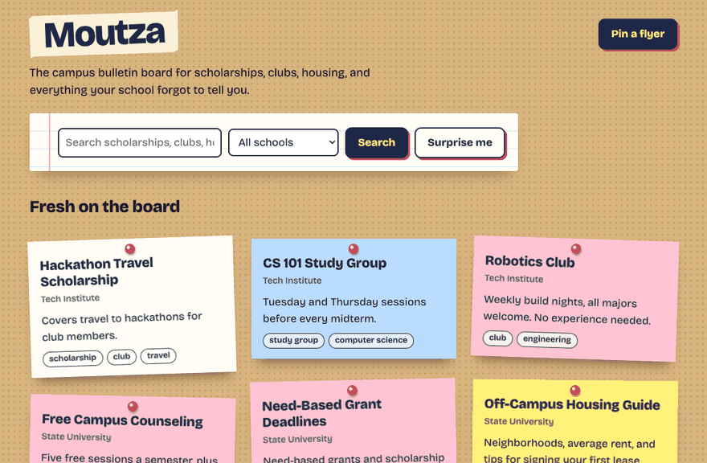
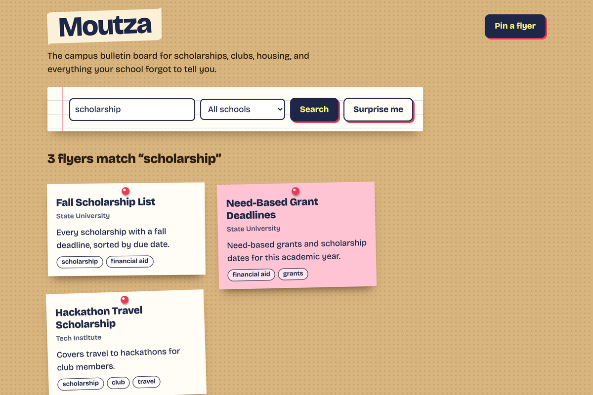
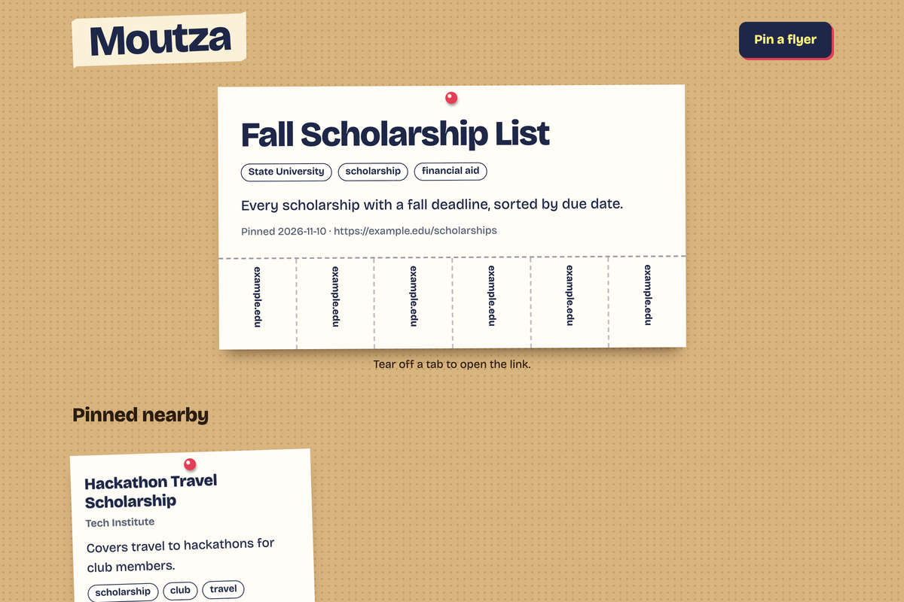
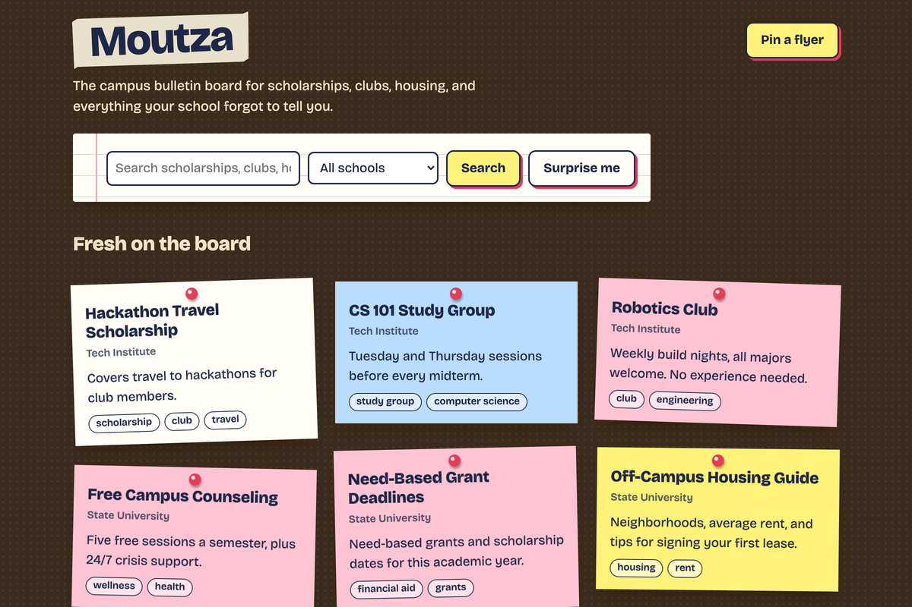
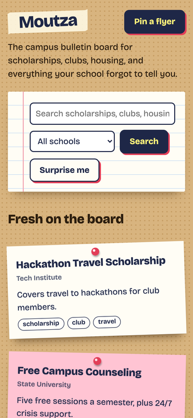

<div align="center">

# 📌 Moutza

**The campus bulletin board for scholarships, clubs, housing, and everything your school forgot to tell you.**




</div>

Every resource is a paper flyer pinned to a cork board, colored by its topic. Students pin what they found useful; everyone else finds it in seconds.

## ✨ What you can do

| | |
|---|---|
| 📌 **Pin a flyer** | Share a link with a title, school, tags, and a short description. |
| 🔍 **Search the board** | Results are ranked by relevance (TF-IDF, computed locally: no AI service, no cost), and you can filter by school. |
| ✂️ **Tear off a tab** | Each flyer has tear-off tabs along the bottom, like the real thing. Click one to open the link. |
| 🧲 **Pinned nearby** | Every flyer suggests related flyers, so one good find leads to the next. |
| 🎲 **Surprise me** | Opens a random flyer. Great for discovering things you didn't know to look for. |
| 🌙 **Day and night** | Follows your system's dark mode, works on phones, and respects reduced motion. |

## 📸 Screenshots

| Search results | A flyer up close |
|---|---|
|  |  |

| After dark | On a phone |
|---|---|
|  |  |

## 🚀 Run it

All you need is Python 3.9 or newer. There's nothing to install.

```sh
python3 app.py          # → http://localhost:8000
python3 app.py 9000     # or pick a port
```

Flyers are saved to `moutza.db` (SQLite) in the folder you run it from. Delete the file for a fresh board.

## 🧪 Test it

```sh
python3 -m unittest -v
```

The tests start a real server and cover pinning, search ranking, the school filter, Pinned nearby, Surprise me, rejected input (bad links, missing fields, oversized posts), and HTML escaping.

## 🗂️ How it's built

One file, `app.py`, using only Python's standard library:

- **`http.server`** serves the pages and handles the forms.
- **`sqlite3`** stores the flyers.
- **TF-IDF** (term frequency-inverse document frequency) search and Pinned nearby are about 30 lines of plain Python.
- **HTML and CSS** are rendered on the server, with no JavaScript. Every user-supplied value is escaped, and only `http`/`https` links are accepted.

## 🛣️ Ideas for later

- [ ] Accounts, so people can edit or remove their own flyers (and to keep spam out before going public)
- [ ] SQLite full-text search once the board passes ~10,000 flyers
- [ ] Flagging outdated or broken links
